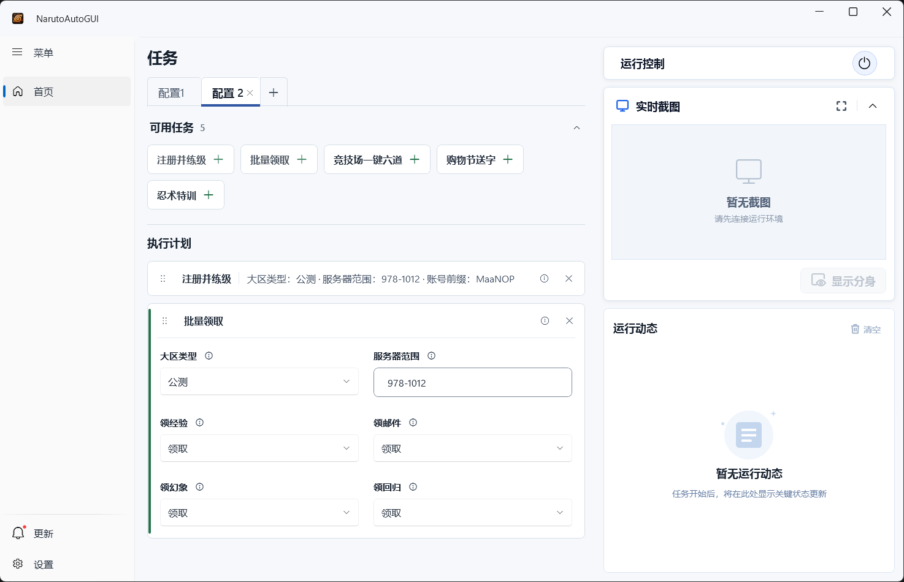

<!-- markdownlint-disable MD033 MD041 -->
<div align="center">
  

# Bunshin

[MaaNOP](https://github.com/ArcherSore/MaaNOP) 的 Windows 桌面界面

[](./LICENSE)
[](https://dotnet.microsoft.com/)
[](https://github.com/ArcherSore/Bunshin)
[](https://github.com/ArcherSore/Bunshin/stargazers)

</div>

## 项目简介

Bunshin 是 [MaaNOP](https://github.com/ArcherSore/MaaNOP) 的图形界面。它通过 Windows Child Session（桌面分身）
在独立会话中运行火影忍者 Online 和自动化任务，不占用你正在使用的桌面。

本仓库只发布前端及配套运行组件，不包含游戏任务资源。请前往 [MaaNOP](https://github.com/ArcherSore/MaaNOP) 获取完整包。

## 主要功能

- **桌面分身**：创建和管理独立运行环境，隐藏分身窗口后游戏和任务仍会继续。
- **任务配置**：多份独立配置，标签页切换，可从项目预设新建；每份配置分别保存任务、启动阶段及参数。
- **运行监控**：查看任务动态，通过小窗只读观看分身，大窗可手动解锁操作。
- **自动运行**：开机自启动、启动后自动执行配置，也可通过命令行接入计划任务或外部脚本。
- **提醒与诊断**：后台任务完成或失败时提醒，设置页可一键导出日志与版本信息。
- **完整包更新**：更新检查、版本说明、下载与安装。

## 界面预览

<p align="center">
  
</p>

## 运行要求

| 项目 | 要求 |
|:---|:---|
| 系统 | Windows 10 / 11 x64 |
| 资源 | 带游戏资源的 [MaaNOP](https://github.com/ArcherSore/MaaNOP) 完整包 |

## 快速开始

1. 前往 [MaaNOP](https://github.com/ArcherSore/MaaNOP) 下载完整包并解压。
2. 运行 `Bunshin.exe`，按提示允许管理员权限。
3. 阅读[用户使用手册](docs/USER-GUIDE.md)，完成 Windows 凭据和 QQ 大厅自动启动的一次性配置。

## 启动参数

| 参数 | 作用 |
|:---|:---|
| `-h`, `--help` | 显示命令行帮助并退出 |
| `--autostart` | 按开机自启处理：窗口留在托盘，并自动执行配置 |
| `-i <配置>`, `--instance <配置>` | 仅配合 `--autostart`：按名称或配置 ID 指定要执行的配置 |
| `-q`, `--quit-after-run` | 自动执行结束后退出程序 |

```powershell
.\Bunshin.exe --autostart -i "日常任务" -q
```

推荐用法见[用户使用手册](docs/USER-GUIDE.md#三命令行启动)。

## 开发

需要 .NET 10 SDK、Rust 1.98.1 MSVC 和 Visual Studio C++ Build Tools。

```powershell
# 构建发布包，产物位于 artifacts\Bunshin\win-x64
.\src\Gui\scripts\build.ps1

# 日常验证：增量 GUI 构建 + GUI 自检
.\src\Gui\scripts\verify.ps1
```

验证要求见 [AGENTS.md](AGENTS.md)，开发入口见[领域术语](GLOSSARY.md)、[当前架构](docs/ARCHITECTURE.md)、
[架构决策](docs/adr/)、[GUI 开发说明](src/Gui/README.md)。
当前工作与验收条件在 [GitHub Issues](https://github.com/ArcherSore/Bunshin/issues)。

## 鸣谢

- [MaaNOP](https://github.com/ArcherSore/MaaNOP)：游戏自动化任务与资源。
- [MaaFramework](https://github.com/MaaXYZ/MaaFramework)：自动化执行框架。
- [BetterGI](https://github.com/babalae/better-genshin-impact)：桌面分身方案参考了其 v0.63.0 引入的 Windows Child Session 实现。

## 许可证

[GPL-3.0](./LICENSE)。第三方组件见 [THIRD_PARTY_NOTICES.md](THIRD_PARTY_NOTICES.md)。
